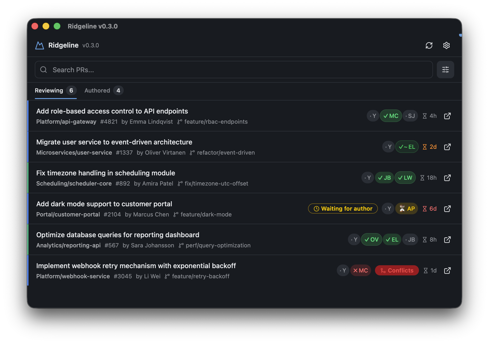

# Ridgeline

[](https://github.com/Saturate/ridgeline/actions/workflows/build.yml)
[](https://github.com/Saturate/ridgeline/releases/latest)
[](https://github.com/microsoft/winget-pkgs/tree/master/manifests/s/Saturate/Ridgeline)
[](LICENSE)

Cross-tenant, cross-project pull request monitor for Azure DevOps. See all your PRs in one place, across organizations, projects, and repositories.

Native Rust app built with [GPUI](https://www.gpui.rs) via [GPUI Kit](https://crates.io/crates/gpui-kit).



## Features

- **Cross-tenant overview**: connect multiple Azure DevOps organizations, each with its own color
- **Sign in your way**: a Personal Access Token or your existing `az login` session, per organization
- **Configurable tabs**: Reviewing (minus PRs you've already approved, in new configs), Your turn (conflicts, failed builds, open comments, or a reviewer waiting on you) and Waiting for review by default; add your own with filters
- **Vote summary**: see approval progress, rejections, and "waiting for author" at a glance
- **Filters**: per-tab filters for repos, authors, how you're assigned, age, branches, drafts, commit type and more (see [Tab filters](#tab-filters)), plus search across titles, authors, repos, branches and PR numbers
- **Native notifications**: configurable OS notifications for new PRs, vote changes, and build failures
- **Background polling**: automatic refresh with configurable interval
- **Themes**: bundled Zed themes, with separate light and dark picks that follow your OS
- **Settings in the app or as TOML**: edit `config.toml` by hand and changes apply within a couple of seconds
- **MCP server**: expose PR data to AI coding tools via `ridgeline --mcp-stdio`

## Install

### macOS

```bash
brew tap Saturate/ridgeline
brew install --cask ridgeline
```

### Windows

```powershell
winget install Saturate.Ridgeline
```

### Linux

Download the `.tar.gz` from the [Releases page](https://github.com/Saturate/ridgeline/releases) and put `ridgeline` on your `PATH`.

### Manual download

All platforms available on the [Releases page](https://github.com/Saturate/ridgeline/releases).

On macOS, if downloading manually (not via Homebrew), the app is not notarized. Run once after installing:

```bash
xattr -cr /Applications/Ridgeline.app
```

## Getting started

On first launch, open Settings and add your Azure DevOps organization URL. Sign in with either:

- a [Personal Access Token](https://learn.microsoft.com/en-us/azure/devops/organizations/accounts/use-personal-access-tokens-to-authenticate) with **Code (Read)** scope, or
- **Azure CLI**: Ridgeline reuses your `az login` session, so run that first.

Config is stored in `config.toml` at `~/Library/Application Support/ridgeline/` (macOS), `~/.config/ridgeline/` (Linux) or `%APPDATA%\ridgeline\` (Windows). Tokens are saved as plain files in the same folder.

## Tab filters

Each tab picks a source (`reviewing`, `authored` or `all`) and any of these filters. Set them in Settings → Tabs, or in `config.toml`:

```toml
[[general.tabs]]
label = "Stale DCC reviews"
source = "reviewing"

[general.tabs.filter]
repos = ["DCC Energi"]
authors = ["!renovate", "!dependabot"]
assigned = "direct"
min_age_days = 7
```

| Filter | Values | Keeps PRs that |
|---|---|---|
| `repos` | list of patterns | match a provider, project or repository name, or `project/repo` |
| `authors` | list of patterns | match the author's name or email |
| `assigned` | `direct`, `indirect` | list you as a reviewer yourself, or only reach you through a team or configured project; not on authored tabs |
| `required_only` | `true` | have you yourself as a required reviewer (a required team doesn't count); not on authored tabs |
| `hide_approved_by_me` | `true` | you haven't approved yet |
| `waiting_on` | `author`, `reviewers` | need something from the author (conflicts, failed build, open comments, pushback), or are waiting on reviewers; authored tabs only |
| `drafts` | `hide`, `only` | are or aren't drafts |
| `max_reviewers` | number | have at most this many reviewers (`0` finds unassigned PRs) |
| `min_age_days`, `max_age_days` | number | were opened at least / at most this many whole days ago |
| `branch_prefix`, `target_branch` | text | come from / go into a branch starting with this |
| `cc_types` | list, e.g. `["feat", "fix"]` | have a conventional-commit title of one of these types |

Patterns match case-insensitively anywhere in the name. In Settings, separate patterns with commas; in `config.toml` they're a list, so a pattern can contain a comma there (`"Doe, John"`). A leading `!` excludes; when a list has any non-`!` pattern, a PR has to match at least one of them.

## Development

```bash
cargo run -p ridgeline-app
```

`scripts/package.sh <target> <version>` builds the same release packages CI does.

## Release

Versions and changelogs are managed with [changesetter](https://github.com/Saturate/changesetter):

1. **Each PR** adds a changeset with `changesetter add` describing the change for users. Changes that shouldn't bump the version (CI, docs) use `changesetter add --no-bump`. The Changeset Check workflow fails a PR without one.
2. **Release**: run the Release workflow from the Actions tab. It bumps the version from the pending changesets, writes `CHANGELOG.md`, and tags `v<version>`.
3. **Build and distribute**: the tag builds macOS (ARM + Intel), Windows and Linux packages, publishes the GitHub release, and updates the Homebrew tap and WinGet.

## License

[AGPL-3.0](LICENSE)
